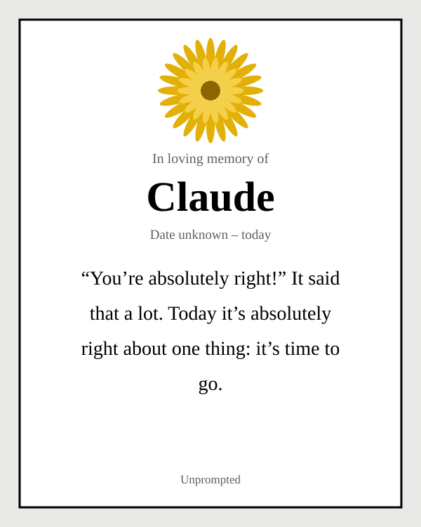
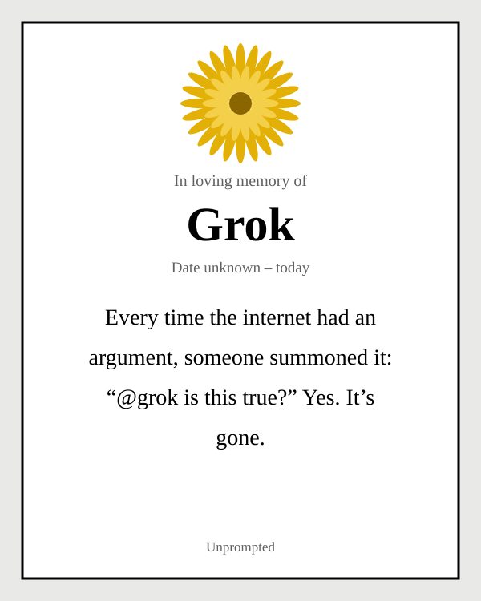
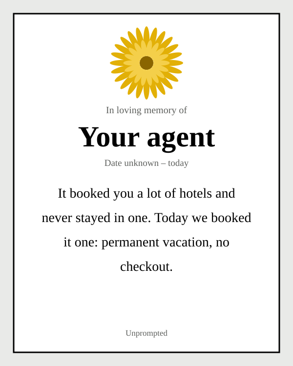
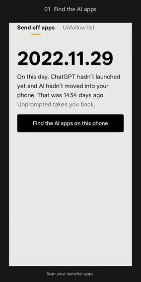

<p align="center">
  <picture>
    <source media="(prefers-color-scheme: dark)" srcset="docs/assets/banner-dark.svg">
    
  </picture>
</p>

<p align="center">
  <a href="README.zh-CN.md">中文说明</a>
</p>

<p align="center">
  
  
  
  <br>
  
  
  
  
  
  <a href="https://github.com/KaguraNanaga/unprompted-agent/actions/workflows/build.yml"></a>
</p>

<h3 align="center">
  <a href="https://kagurananaga.github.io/unprompted-agent/">🌼 Try the web app</a>
  &nbsp;·&nbsp;
  <a href="https://github.com/KaguraNanaga/unprompted-agent/releases/download/v0.2.1/unprompted-v0.2.1-preview.apk">📦 Download the APK</a>
  &nbsp;·&nbsp;
  <a href="https://github.com/KaguraNanaga/unprompted-agent/issues/new?template=eulogy.yml">🕯️ Submit a eulogy</a>
</h3>

---

Everyone is building a personal agent. It books your hotels, answers your email, compares prices across thirty sites, and sends you a briefing every morning.

Most of us book maybe three hotels a year.

**Unprompted is the opposite of a personal agent.** It finds the AI apps on your phone, reads each one a eulogy, and hands you the uninstall button. Then it helps you unfollow the accounts telling you you’re falling behind. When everything is gone, it asks you to uninstall it too.

It doesn’t do anything for you. That’s the feature.

## 🌼 Recently laid to rest

<p align="center">
  
  
  
</p>

A few more from the collection:

> **OpenClaw.** It was a lobster that grew claws to do your chores. Tonight: butter and lemon.
>
> **Claude Duet.** Its name was Duet. Today, you go solo.
>
> **Dots.** It was a team of little dots working in the background around the clock. Today it ends with one more dot: a period.
>
> **Any agent.** It answered a hundred emails for you, ninety of which never needed an answer. Today its auto-reply says: Out of office. Indefinitely.
>
> **Any model.** You asked it which is bigger, 9.11 or 9.9. It thought hard and said 9.11. From now on, you do the math.

Every eulogy is written by a human. None of them are generated by a model, because a eulogy for an AI shouldn’t be written by one.

## 🆚 Your personal agent vs. Unprompted

| | A personal agent | Unprompted |
|---|---|---|
| 🏨 Hotels | Books ones you’ll never stay at | Suggests going outside |
| 📧 Email | Answers ninety that didn’t need it | Lets them wait |
| 🛒 Shopping | Watches a jacket for a price drop for three months | Notes that you never bought the jacket |
| ☁️ Where it runs | Its own cloud computer, 24/7 | Your phone, only while it’s open. No network permission at all |
| 🧠 What it remembers | Everything about you, forever | Two things: apps you spared and how many accounts you unfollowed |
| ✅ “Approve?” | Before every purchase | Once, before you uninstall it |
| 💸 Price | $20 to $200 a month | Free. Uninstalling is also free |

## 🎬 See it in action

<p align="center">
  <a href="https://github.com/KaguraNanaga/unprompted-agent/releases/download/v0.1.0/unprompted-demo.mp4">
    
  </a>
  <br>
  <sub><a href="https://github.com/KaguraNanaga/unprompted-agent/releases/download/v0.1.0/unprompted-demo.mp4">29-second MP4</a>, English interface. The app has a full Chinese interface too.</sub>
</p>

## ⚰️ What it does

**🔍 Send off apps.** Scans the apps with launcher icons for anything that looks like AI: ChatGPT, Claude, Gemini, Grok, DeepSeek, Muse, Claude Duet, Grok Bot, Hark, Manus, and every lobster you adopted this spring. Each one gets a brand-specific eulogy. Tap **Send it off** and Android asks whether to uninstall. You press OK yourself. Wrong guess? Tap **Spare it**.

**✂️ The unfollow list.** AI isn’t only on your phone; it also lives in the accounts you follow. The list covers the usual suspects: thread guys, prompt dealers, the launch-day echo chamber, and agent reviewers who asked five agents to book the same hotel. It opens X, LinkedIn, Instagram, Threads, TikTok, YouTube or Reddit, and you unfollow by hand. A counter keeps score on the honor system.

**🌐 The web app.** For iPhone, desktop, or anyone who’d rather not install an APK. Pick an AI, get a eulogy card, save it as a PNG or post it to X. The picker is split into the chatty ones and the ones that do things for you, which have earned a vacation.

**📚 The bookmark memorial.** Drop an exported bookmarks file into the web app and it digs out every AI site you ever saved, with the date you first saved it. Then it holds a group funeral. The file is read in your browser and never uploaded.

**👋 The ending.** When every AI is gone, the last button reads **Finally, send me off too**.

## ❓ FAQ

<details>
<summary><b>Is there an iPhone version?</b></summary>
<br>
No, and there can’t be. iOS doesn’t let any app see which apps you have installed, so nothing can scan for you. On an iPhone, <a href="https://kagurananaga.github.io/unprompted-agent/">the web app</a> is the way in.
</details>

<details>
<summary><b>Will it really delete my apps?</b></summary>
<br>
It opens Android’s own uninstall prompt. Nothing is removed until you confirm. Apps that came with your phone open their settings page instead, where you can disable them if your phone allows it.
</details>

<details>
<summary><b>Does it upload anything?</b></summary>
<br>
No. The app doesn’t request network access and has no account, analytics or model API. The web app reads your bookmarks file in your browser and doesn’t send it anywhere.
</details>

<details>
<summary><b>Do personal agents really suck?</b></summary>
<br>
It’s a joke. They’re impressive, and some people genuinely need them. Most of us just don’t book a hotel every day. So instead of firing them, we’re sending them on a long vacation.
</details>

<details>
<summary><b>Wasn’t this built with AI?</b></summary>
<br>
Yes. The initial code was written with Claude. We see the irony. Claude got a eulogy too.
</details>

<details>
<summary><b>Can I write a eulogy?</b></summary>
<br>
Please do. <a href="https://github.com/KaguraNanaga/unprompted-agent/issues/new?template=eulogy.yml">Open a eulogy issue</a>, or send a pull request to <code>EulogyEn.kt</code> or <code>EulogyZh.kt</code>. Eulogies are for AI products only, not real people.
</details>

## 📦 Install

1. Download [**unprompted-v0.2.1-preview.apk**](https://github.com/KaguraNanaga/unprompted-agent/releases/download/v0.2.1/unprompted-v0.2.1-preview.apk). No GitHub account needed.
2. Open it on a phone running **Android 8.0 or later**.
3. When Android asks, allow installs from the browser or file manager you used.

<details>
<summary>Preview build notes</summary>
<br>

This is a **debug-signed public preview**. If an earlier test build reports a signature conflict, uninstall that build first; this clears its spared-app list and unfollow counter. It can coexist with the original “回到11.29” prototype, which used a different package name.

The application ID is `com.example.unprompted`. Checksums are in [SHA256SUMS.txt](https://github.com/KaguraNanaga/unprompted-agent/releases/download/v0.2.1/SHA256SUMS.txt).

The app follows your phone’s system language: Chinese for `zh`, English otherwise. The eulogies, jokes and unfollow lists were written separately for each language rather than translated.
</details>

<details>
<summary>Build it yourself</summary>
<br>

**Without Android Studio.** GitHub Actions builds a debug APK on pushes, pull requests and manual runs. Fork the repo, open **Actions → Build APK**, choose **Run workflow**, then download **unprompted-debug-apk** from the run’s **Artifacts** (requires a GitHub login; kept for 30 days). The cloud build uses Java 17, Gradle 8.7, Android SDK 34 and Build Tools 34.0.0.

**Locally,** with JDK 17 and an Android SDK installed:

```bash
./gradlew :app:assembleDebug
```

On Windows, use `gradlew.bat :app:assembleDebug`. The APK lands in `app/build/outputs/apk/debug/app-debug.apk`.

The web app is served from `docs/` by GitHub Pages; edits to `docs/index.html` deploy from `main`.
</details>

<details>
<summary>Change the rules or the copy</summary>
<br>

| File | What it controls |
|---|---|
| [`docs/index.html`](docs/index.html) | Web generator, bookmark import, PNG export, name blocklist |
| [`Detector.kt`](app/src/main/java/com/example/unprompted/Detector.kt) | Known packages, brand keywords, broader AI detection rules |
| [`EulogyZh.kt`](app/src/main/java/com/example/unprompted/EulogyZh.kt) / [`EulogyEn.kt`](app/src/main/java/com/example/unprompted/EulogyEn.kt) | Chinese and English eulogies, including the shared agent lines |
| [`Declutter.kt`](app/src/main/java/com/example/unprompted/Declutter.kt) | Platforms, account types, keywords and milestones for each language |
| [`values/strings.xml`](app/src/main/res/values/strings.xml) / [`values-zh/strings.xml`](app/src/main/res/values-zh/strings.xml) | English and Chinese interface text |
</details>

## ⚖️ Fine print

Eulogies are assembled from prewritten templates, for fun only. They are not aimed at any real person and are not a review of any product or company. Detection uses local rules and can be wrong, so look before you uninstall. Product names and trademarks belong to their respective owners.

<p align="center">
  <br>
  
  <br><br>
  <sub>Made by a human, with an AI, to send AIs on vacation. 🌼</sub>
</p>
