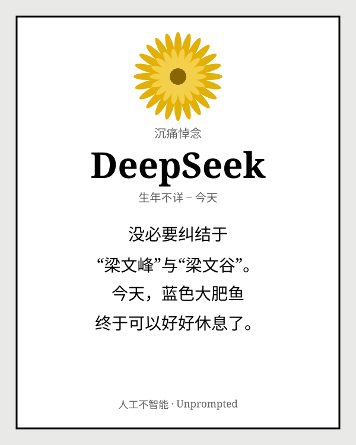
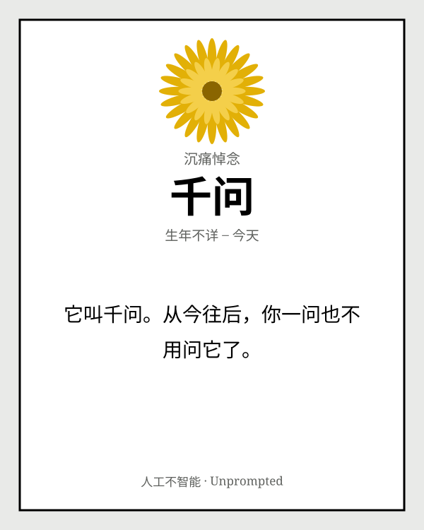
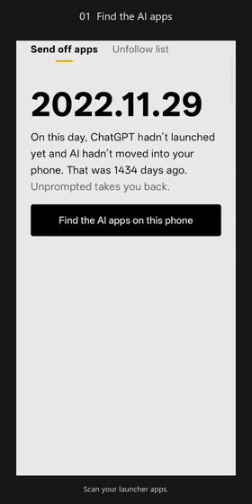

<p align="center">
  <picture>
    <source media="(prefers-color-scheme: dark)" srcset="docs/assets/banner-dark.svg">
    
  </picture>
</p>

<p align="center">
  <a href="README.md">English</a>
</p>

<p align="center">
  
  
  
  <br>
  
  
  
  
  
  <a href="https://github.com/KaguraNanaga/unprompted-agent/actions/workflows/build.yml"></a>
</p>

<h3 align="center">
  <a href="https://kagurananaga.github.io/unprompted-agent/">🌼 打开网页版</a>
  &nbsp;·&nbsp;
  <a href="https://github.com/KaguraNanaga/unprompted-agent/releases/download/v0.2.1/unprompted-v0.2.1-preview.apk">📦 下载安卓 APK</a>
  &nbsp;·&nbsp;
  <a href="https://github.com/KaguraNanaga/unprompted-agent/issues/new?template=eulogy.yml">🕯️ 投稿一篇悼词</a>
</h3>

---

继百模大战、春晚跳舞机器人、世界模型、办公Agent之后，我们迎来了一级市场又一个宠儿：personal agent。
所有的Personal Agent无不号称可以替你订酒店、回邮件、比三十家的价，每天早上给你发一份早报，说一下目前市场上最新行情，或者是AI行业的最新新闻，或者是帮你提高生产率。

然而，
你一年也订不了几次酒店，出不了几次远门；
工作中也没有那么多周报日报需要处理，没有多少人给你发邮件和微信消息；
没有那么多的新闻需要去关注。所谓的深度AI公众号、播客和文章，早已沦为创始人宣发产品的一种手段。
至于 How to fix your life in one day，以及提高生产率，更是一种渲染焦虑的梦。

**「人工不智能」是一个反向的 personal agent。** 它找出你手机里的每一个 AI 和 Personal Agent，给它们念一段悼词，然后把卸载键交给你。再陪你去取关那些“不会 AI 就要被淘汰”“初中生用好AI实现财务自由”“我用AI做了○○补光灯”的博主。等它们都走了，这个Agent会请你把它也卸载掉。

当然，和那些想方设法窃取你的个人隐私与数据，核心能力只能依赖AI模型供应商的Personal Agent不同，这款产品无需联网，不会窃取你的个人信息，数据完全留在你的设备本地。

这就是它的功能。

## 🌼 最近安息的几位

<p align="center">
  
  
  
</p>

还有这些：

> **Claude**　You’re absolutely right! 再也不用扮演美国人和新加坡人，成天担心被Ban掉了。
>
> **OpenClaw**　摘下龙虾帽，是时候从AI无所不能的美梦里醒过来了。
>
> **豆包**　豆包将用最简洁最直白最不绕弯子的方式离开。
>
> **所有 Agent**　放弃吧，没人给你发消息，也没人给你发邮件，更没有那么多的事情值得你瞎忙活。
>
> **所有模型**　你醒了，今天是2022年11月29日，你一直念叨的ChatGPT和AI是什么呀，快起来干活啦。

每一篇悼词都是人写的，没有一篇是大模型生成的。送走 AI 的悼词，不该由 AI 来写。

## 🆚 你的 Personal Agent 和人工不智能

| | Personal Agent | 人工不智能 |
|---|---|---|
| 🏨 订酒店 | 订了一堆你不会去住的 | 建议你出门走走 |
| 📧 回邮件 | 回了九十封本来不用回的 | 建议清空收件箱 |
| 🛒 比价 | 替你盯一件衣服的降价，盯了三个月 | 提醒你：那件衣服你后来没买 |
| ☁️ 住在哪 | 自己的云电脑，二十四小时不关机 | 你的手机，打开才运行，不需要联网 |
| 🧠 记得什么 | 你的全部个人信息 | 两件事：你放过了哪些 App，你取关了几个账号 |
| 💸 价格 | 每月 20 到 200 美元 | 免费 |

## 🎬 看它怎么用

<p align="center">
  <a href="https://github.com/KaguraNanaga/unprompted-agent/releases/download/v0.1.0/unprompted-demo.mp4">
    
  </a>
  <br>
  <sub><a href="https://github.com/KaguraNanaga/unprompted-agent/releases/download/v0.1.0/unprompted-demo.mp4">29 秒 MP4</a>，录的是英文界面。App 有完整的中文界面，手机语言是中文就会显示。</sub>
</p>

## ⚰️ 它能干什么

**🔍 送走 App。** 扫描所有带桌面图标的 App，找出像 AI 的那些：ChatGPT、Claude、Gemini、DeepSeek、豆包、千问、Kimi、元宝、Muse、Claude Duet、Grok Bot、Hark，还有你今年春天养的每一只龙虾。每个 AI 都有专属悼词。点“送走它”，系统会问你是否卸载，确定要你亲手按。认错了，点“放过它”。

**✂️ 断舍离清单。** AI 不只装在手机里，也住在你的关注列表里。清单列出了该取关的几类账号：提效博主、焦虑贩卖号、提示词商贩、养虾教程号，还有让五个 Agent 同时订同一家酒店的横评号。一键打开小红书、公众号、微博、抖音、B站、知乎、即刻，亲手取关，回来点一下计数。没人检查，全凭良心。

**🌐 网页版。** 给 iPhone、电脑，以及不想装 APK 的人。选一个 AI，生成一张悼词卡片，保存成图片或分享到 X。选择区分成两组：陪你聊天的，和替你干活的。后者辛苦了，放个假吧。

**📚 书签追悼会。** 把浏览器导出的书签文件拖进网页版，它会翻出你收藏过的每一个 AI 网站，连第一次收藏的日期都有，然后给它们办一场集体追悼会。文件只在你的浏览器里读取，不会上传。

**👋 最后。** 等所有 AI 都送走了，最后一个按钮是：“最后，把我也送走”。

## ❓ 常见问题

<details>
<summary><b>有 iPhone 版吗？</b></summary>
<br>
没有，也做不了。苹果不允许任何 App 查看你装了哪些 App，所以没法自动扫描。iPhone 上请用<a href="https://kagurananaga.github.io/unprompted-agent/">网页版</a>。
</details>

<details>
<summary><b>它真的会删掉我的 App 吗？</b></summary>
<br>
它只是打开安卓系统自己的卸载确认框，你不按确定，什么都不会被删。手机自带的 App 会跳到它的设置页，能不能停用取决于你的手机。
</details>

<details>
<summary><b>会上传我的数据吗？</b></summary>
<br>
不会。App 没有申请网络权限，没有账号、统计 SDK 或大模型接口。网页版读取书签文件也只在你的浏览器里进行。
</details>

<details>
<summary><b>Personal Agent 真的不行吗？</b></summary>
<br>
这是个玩笑。它们其实很厉害，也确实有人需要。只是这并不是一个大众化的需求，大多数人并不需要天天订酒店。所以我们不是开除它们，是送它们去放个长假。
</details>

<details>
<summary><b>这个项目不是 AI 写的吗？</b></summary>
<br>
是的，初版代码由 Claude 编写。我们知道这很讽刺。Claude 也有自己的悼词。
</details>

<details>
<summary><b>我能写一篇悼词吗？</b></summary>
<br>
非常欢迎。<a href="https://github.com/KaguraNanaga/unprompted-agent/issues/new?template=eulogy.yml">开一个悼词投稿 issue</a>，或者直接给 <code>EulogyZh.kt</code>、<code>EulogyEn.kt</code> 提 PR。悼词只写给 AI 产品，不写给真实的人。
</details>

## 📦 安装

1. 下载 [**unprompted-v0.2.1-preview.apk**](https://github.com/KaguraNanaga/unprompted-agent/releases/download/v0.2.1/unprompted-v0.2.1-preview.apk)，不需要 GitHub 账号。
2. 在 **安卓 8.0 及以上** 的手机上打开它。
3. 系统询问时，允许你用的浏览器或文件管理器安装应用。

<details>
<summary>预览版说明</summary>
<br>

这是一个 **debug 签名的公开预览版**。如果之前装过测试版、提示签名冲突，请先卸载旧版，旧版里“放过”的 App 和取关计数会一起清空。它可以和最早的“回到11.29”原型共存，因为两者包名不同。

应用 ID 是 `com.example.unprompted`，校验值见 [SHA256SUMS.txt](https://github.com/KaguraNanaga/unprompted-agent/releases/download/v0.2.1/SHA256SUMS.txt)。

App 跟随手机系统语言：中文系统显示中文，其他语言显示英文。两种语言的悼词、梗和断舍离清单是分别写的，不是互相翻译的。
</details>

<details>
<summary>自己编译</summary>
<br>

**不装 Android Studio。** 每次推送代码、提 PR 或手动运行时，GitHub Actions 都会编译一个 debug APK。Fork 仓库，打开 **Actions → Build APK**，点 **Run workflow**，运行成功后在 **Artifacts** 里下载 **unprompted-debug-apk**（需要登录 GitHub，保留 30 天）。云端编译使用 Java 17、Gradle 8.7、Android SDK 34 和 Build Tools 34.0.0。

**本地编译**，需要已经装好 JDK 17 和安卓 SDK：

```bash
./gradlew :app:assembleDebug
```

Windows 上用 `gradlew.bat :app:assembleDebug`。APK 会输出到 `app/build/outputs/apk/debug/app-debug.apk`。

网页版由 GitHub Pages 从 `docs/` 目录发布，修改 `docs/index.html` 并推送到 `main` 即可更新。
</details>

<details>
<summary>改规则和文案</summary>
<br>

| 文件 | 管什么 |
|---|---|
| [`docs/index.html`](docs/index.html) | 网页版生成器、书签导入、图片导出、名字屏蔽清单 |
| [`Detector.kt`](app/src/main/java/com/example/unprompted/Detector.kt) | 已知包名、品牌关键词和更宽的 AI 识别规则 |
| [`EulogyZh.kt`](app/src/main/java/com/example/unprompted/EulogyZh.kt) / [`EulogyEn.kt`](app/src/main/java/com/example/unprompted/EulogyEn.kt) | 中英文悼词，包括 Agent 共用的那组 |
| [`Declutter.kt`](app/src/main/java/com/example/unprompted/Declutter.kt) | 各语言的平台、账号类型、关键词和取关里程碑 |
| [`values/strings.xml`](app/src/main/res/values/strings.xml) / [`values-zh/strings.xml`](app/src/main/res/values-zh/strings.xml) | 英文和中文界面文字 |
</details>

## ⚖️ 免责声明

悼词由预设模板随机组合生成，仅供娱乐，不针对任何真实个人，也不代表对任何产品或公司的评价。识别规则在本地运行，可能认错，卸载前请自己看一眼。文中提到的产品名称和商标归各自所有者所有。

<p align="center">
  <br>
  
  <br><br>
  <sub>一个人，借一个 AI，送所有 AI 去放假。🌼</sub>
</p>
